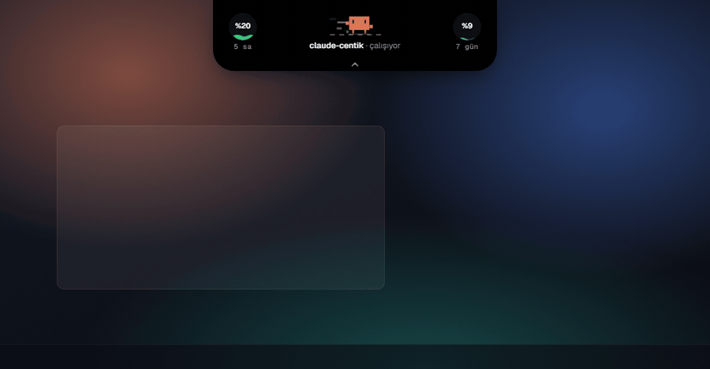
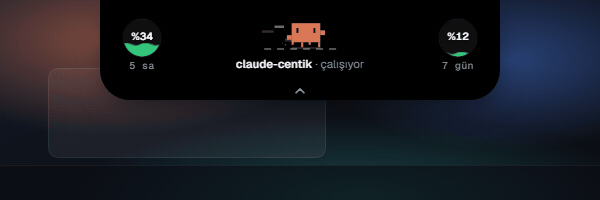
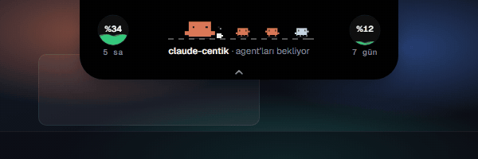
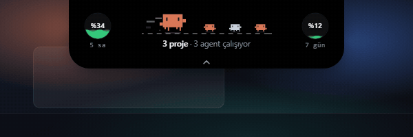
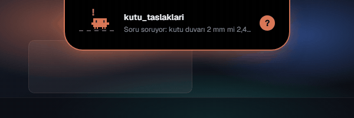
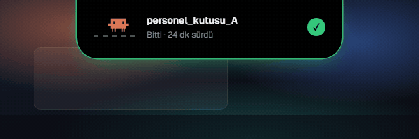
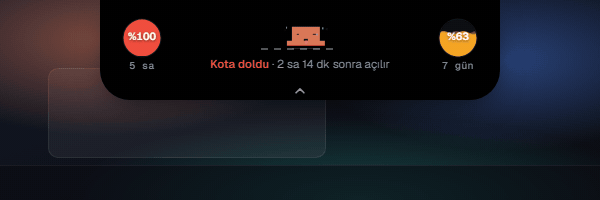
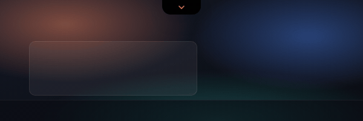
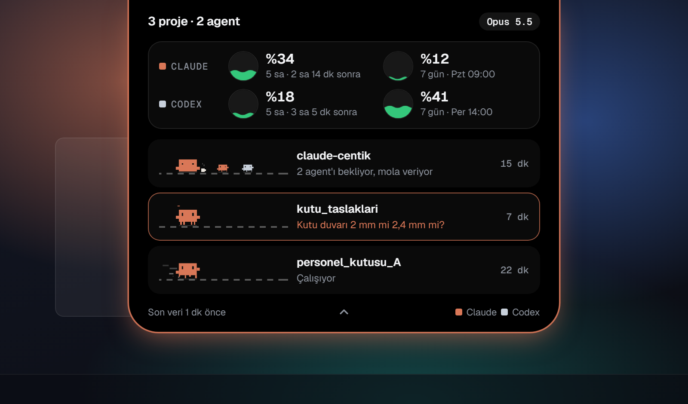

<div align="center">



[](LICENSE)


A small black notch at the top of your screen. While Claude works, a pixel Claude runs inside it.
When it hands work to agents, it sits down for a break and the agents run beside it.
Your 5-hour and weekly quota fill up like liquid on either side.



[Features](#features) · [How it works](#how-it-works) · [Install](#install) · [Build from source](#build-from-source) · [Türkçe](#türkçe)

</div>

---

## Why

You start Claude Code in three projects, switch to your browser, and lose track.
Which one is still running? Which one is waiting for your permission? How much of the 5-hour limit is left?

Claude Notch answers that with a glance at the top of the screen. Zero clicks to see, one click for details.

## Features

| | |
|---|---|
|  | **Working.** Claude runs while a session is busy. Left: 5-hour quota. Right: 7-day quota. |
|  | **Agents.** Claude sits with a coffee while its sub-agents run. Orange = Claude agents, grey = Codex (GPT) agents. |
|  | **Several projects.** Up to a few Claude / Codex windows at once, each named after its project folder. |
|  | **Needs you.** When a session asks for permission, the notch opens, names the project and glows orange. |
|  | **Done.** A green ring and the project name, then it goes back to sleep. |
|  | **Out of quota.** Claude is worn out from running: slumped, tongue out, sweating. The notch tells you when the limit resets. |
|  | **Collapsed.** One click on ▲ leaves only an arrow. It still pulses while work is running. |

Click the notch for the full panel: Claude and Codex quotas with reset times, and one row per project with its agents, model, context and cost.



More:

- **Liquid quota gauges** turn amber at 60 % and red at 85 %, and the wave speeds up when you are close to the limit.
- **Sleeps when idle.** Only a thin line stays; hover it to peek at your quotas.
- **Click-through.** The transparent area around the notch never blocks the window below.
- **Hides in full screen** (video, games, presentations) and never steals keyboard focus.
- **Tray menu** with show/hide, break style (coffee or cigarette), start with Windows (off by default) and quit.

## How it works

The notch **uses no tokens and talks to no AI service.** It only reads small local files.

```
Claude Code ──hooks──▶ hooks/claude-hook.js ─┐
Codex CLI   ──hooks──▶ (same script, --source codex)
status line ─────────▶ statusline.js ────────┤──▶ ~/.claude/usage/centik/*.json ──▶ Tauri app (reads every second)
calistir-style workers ─▶ workers/<pid>.json ┘
```

- **Hooks** (`SessionStart`, `UserPromptSubmit`, `Notification`/`PermissionRequest`, `SubagentStart/Stop`, `Stop`, `SessionEnd`) run asynchronously and print nothing, so nothing is added to the model's context and Claude never waits for them.
- **Quota** comes from the Claude Code status line (`rate_limits`) and from Codex's own session logs.
- The data format is documented in [`docs/SOZLESME.md`](docs/SOZLESME.md) (Turkish).

## Install

Requirements: Windows 10/11, [Node.js](https://nodejs.org) 18+, Claude Code (and optionally Codex CLI).

1. Download the installer from [Releases](../../releases) and run it. It installs per user and needs no admin rights.
2. Clone this repo (the hook scripts live in `hooks/`) and register the hooks:

   ```bash
   git clone https://github.com/gunhanmehmetakif/claude-notch.git
   cd claude-notch
   node hooks/install.js --codex --statusline
   ```

   - `--codex` also registers the Codex CLI hooks. Open Codex once and approve them with `/hooks`.
   - `--statusline` sets a small status line that records your quota. If you already have your own status line, the script leaves it alone and tells you which two files to write from it.
   - A backup of every file it changes is written next to it. `--dry-run` shows the changes first, `--uninstall` removes only what it added.
3. Open a new Claude Code window and give it a task. The notch starts running.

Optional: right-click the tray icon and enable **"Bilgisayar açılınca başlat"** (start with Windows).

> The interface text is in Turkish for now.

## Build from source

Requirements: Rust (stable, MSVC), Visual Studio Build Tools with "Desktop development with C++", Node.js.

```bash
cd app
npm install
npx tauri build          # installer in app/src-tauri/target/release/bundle/nsis/
```

For development, `cargo build` in `app/src-tauri` and run `target/debug/claude_centik.exe`.
The design mock-up lives in [`docs/tasarim/maket.html`](docs/tasarim/maket.html); open it in a browser to try every state.

Project layout:

```
app/            Tauri 2 app (Rust + plain HTML/CSS/JS, no framework)
hooks/          claude-hook.js, statusline.js, install.js and their tests
docs/           design mock-up, data contract, decisions (Turkish)
```

## Disclaimer

This is an unofficial fan project. It is not affiliated with, endorsed by or sponsored by Anthropic or OpenAI.
"Claude" and the Claude mascot belong to Anthropic; "Codex" belongs to OpenAI.

## License

[MIT](LICENSE)

---

## Türkçe

**Claude Notch (Claude Çentiği)**, Windows ekranının üst ortasında duran, iPhone'daki Dynamic Island benzeri siyah bir çentiktir.

- Claude çalışırken içinde piksel bir Claude koşar. İşi agent'lara verince oturup kahvesini içer, agent'lar yanında koşar (turuncu Claude, gri Codex).
- Birden fazla projeyi aynı anda gösterir. Bir proje soru sorunca veya bitince çentik açılıp proje adını söyler.
- 5 saatlik ve 7 günlük kota sıvı gibi dolan kaplarla gösterilir. Tıklayınca Claude ve Codex kotaları, sıfırlanma saatleri ve proje satırları açılır.
- **Token harcamaz:** hiçbir yapay zekâ servisine bağlanmaz, yalnız Claude Code ve Codex hook'larının yazdığı yerel dosyaları okur.

Kurulum: [Releases](../../releases) sayfasındaki kurulum dosyasını çalıştırın, ardından repo klasöründe `node hooks/install.js --codex --statusline` komutunu çalıştırın. Codex'te hook'ları `/hooks` ile onaylayın.

Tasarım kararları ve teknik notlar `docs/` klasöründedir.
